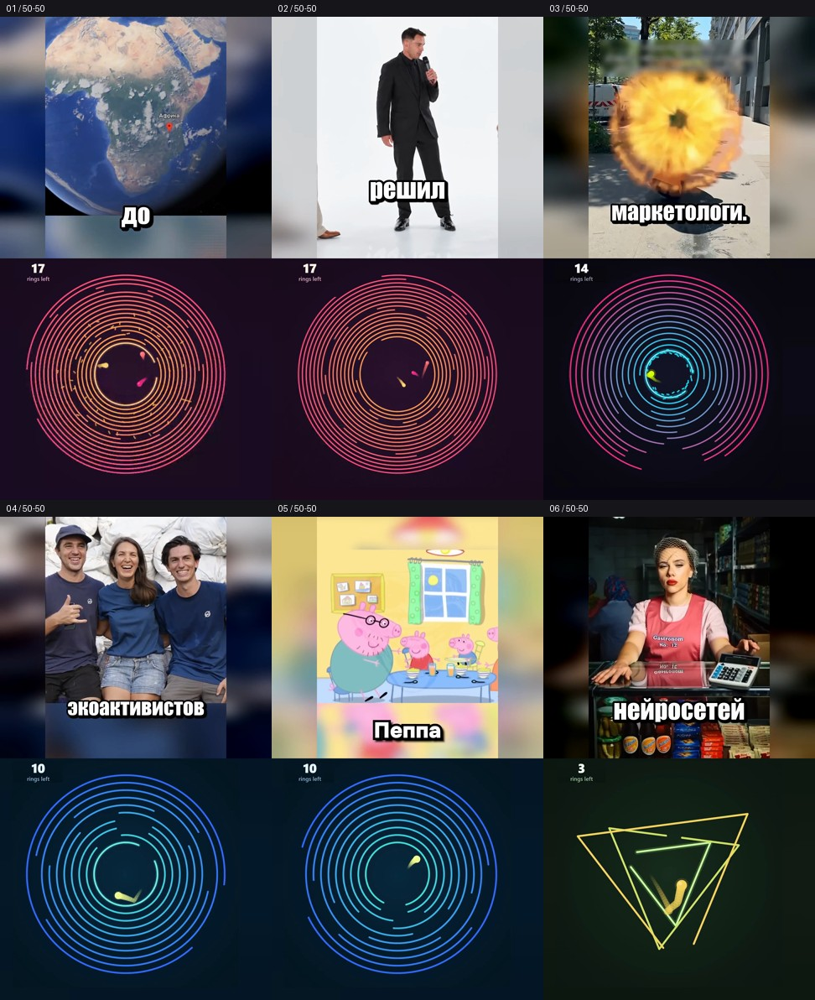

# Шесть роликов + шарики 50/50

Ролики из предоставленной папки Google Drive: основное видео с прежними субтитрами сверху, разные игровые отрезки снизу. Обе половины ровно 1080×960; общий формат 1080×1920, 60 fps. Звук игры полностью отключён. Исходные голос, музыка и эффекты сохранены, скорость и ориентация прежние.

## Скачать подборку

- [Архив 1 — 57.8 МБ](https://raw.githubusercontent.com/kekkill/Videos/main/exports/folder-gameplay-20261019/videos-pack-1.zip) — ролики 2, 5.
- [Архив 2 — 68.5 МБ](https://raw.githubusercontent.com/kekkill/Videos/main/exports/folder-gameplay-20261019/videos-pack-2.zip) — ролики 3, 4.
- [Архив 3 — 69.3 МБ](https://raw.githubusercontent.com/kekkill/Videos/main/exports/folder-gameplay-20261019/videos-pack-3.zip) — ролики 1, 6.

Это независимые ZIP: скачайте и распакуйте все архивы, чтобы получить полную подборку.

## Отдельные MP4

| № | Ролик | Длина | Скачать |
|---|---|---|---|
| 01 | Африканский племенной суд | 49.04 с | [MP4 · 36.7 МБ](https://raw.githubusercontent.com/kekkill/Videos/main/exports/folder-gameplay-20261019/01-african-court-gameplay.mp4) |
| 02 | Готические приключения репера Дрейка | 52.62 с | [MP4 · 40.0 МБ](https://raw.githubusercontent.com/kekkill/Videos/main/exports/folder-gameplay-20261019/02-drake-adventures-gameplay.mp4) |
| 03 | Добрая сова | 57.75 с | [MP4 · 31.6 МБ](https://raw.githubusercontent.com/kekkill/Videos/main/exports/folder-gameplay-20261019/03-kind-owl-gameplay.mp4) |
| 04 | Очистка реки от мусора | 46.97 с | [MP4 · 36.9 МБ](https://raw.githubusercontent.com/kekkill/Videos/main/exports/folder-gameplay-20261019/04-river-cleanup-gameplay.mp4) |
| 05 | Пеппа 10 Канье | 38.55 с | [MP4 · 17.8 МБ](https://raw.githubusercontent.com/kekkill/Videos/main/exports/folder-gameplay-20261019/05-peppa-kanye-gameplay.mp4) |
| 06 | Снова нейронка всех обманула | 56.98 с | [MP4 · 32.6 МБ](https://raw.githubusercontent.com/kekkill/Videos/main/exports/folder-gameplay-20261019/06-ai-deceived-everyone-gameplay.mp4) |

Для лиц и читаемого текста используется верхняя область исходника 1080×1440, равномерно вписанная в 720×960. Нижние 480 пикселей исходного вертикального кадра не показываются в верхнем окне. Края заполнены размытием. Игровое поле равномерно уменьшено до 900×900, кольца не растянуты; счётчик находится в верхнем левом углу нижней половины.

В каждом файле свои старты и сочетания двух или трёх игр. Пустые окончания игровых записей исключены. Новых баннеров, титров, отражения или субтитров нет.

Изображение повторно сжато H.264 CRF18. Все исходные звуковые пакеты скопированы без повторного кодирования. Все кадры основного окна и субтитров, временные метки и каждый игровой отрезок проверены; все шесть MP4 декодируются и воспроизводятся с перемоткой в Chromium. [Отчёт](validation.json). [Проект](../../split-screen-studio/batches/folder-gameplay-20261019/README.md).
