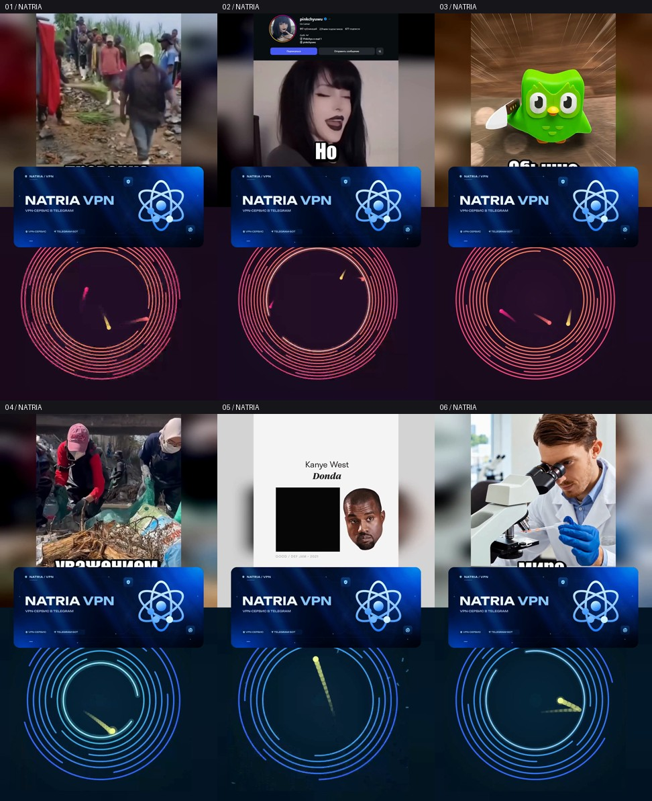

# Шесть роликов с NATRIA VPN

Исходный анимированный баннер расположен ровно по центру каждого ролика. Зелёный фон удалён, дополнительные плашки не добавлены. Вставки выбраны между репликами около середины.

На время озвучки рекламы весь кадр останавливается на 5 секунд, основной звук выключен. Затем ролик продолжается с того же места с приглушённым звуком (−18 dB) до конца анимации, ещё 2,2 секунды. После исчезновения баннера обычная громкость возвращается за 120 мс.

[Посмотреть короткий пример вставки — 9 секунд](https://raw.githubusercontent.com/kekkill/Videos/main/exports/natria-banner-20261019/preview-insertion-9s.mp4). Это пробник, полные ролики ниже.

## Скачать подборку

- [Архив 1 — 88.2 МБ](https://raw.githubusercontent.com/kekkill/Videos/main/exports/natria-banner-20261019/videos-pack-1.zip) — ролики 3, 4, 5.
- [Архив 2 — 96.8 МБ](https://raw.githubusercontent.com/kekkill/Videos/main/exports/natria-banner-20261019/videos-pack-2.zip) — ролики 1, 2, 6.

Это независимые ZIP: скачайте и распакуйте все архивы, чтобы получить полную подборку.

## Отдельные MP4

| № | Ролик | Длина | Вставка | Скачать |
|---|---|---|---|---|
| 01 | Африканский племенной суд | 54.04 с | 25.10 с | [MP4 · 30.5 МБ](https://raw.githubusercontent.com/kekkill/Videos/main/exports/natria-banner-20261019/01-african-court-natria.mp4) |
| 02 | Готические приключения репера Дрейка | 57.62 с | 26.10 с | [MP4 · 33.3 МБ](https://raw.githubusercontent.com/kekkill/Videos/main/exports/natria-banner-20261019/02-drake-adventures-natria.mp4) |
| 03 | Добрая сова | 62.75 с | 27.85 с | [MP4 · 32.4 МБ](https://raw.githubusercontent.com/kekkill/Videos/main/exports/natria-banner-20261019/03-kind-owl-natria.mp4) |
| 04 | Очистка реки от мусора | 51.97 с | 23.37 с | [MP4 · 37.1 МБ](https://raw.githubusercontent.com/kekkill/Videos/main/exports/natria-banner-20261019/04-river-cleanup-natria.mp4) |
| 05 | Пеппа 10 Канье | 43.55 с | 21.27 с | [MP4 · 18.8 МБ](https://raw.githubusercontent.com/kekkill/Videos/main/exports/natria-banner-20261019/05-peppa-kanye-natria.mp4) |
| 06 | Снова нейронка всех обманула | 61.98 с | 31.30 с | [MP4 · 33.0 МБ](https://raw.githubusercontent.com/kekkill/Videos/main/exports/natria-banner-20261019/06-ai-deceived-everyone-natria.mp4) |

Формат 1080×1920, 60 fps, H.264 CRF18. Баннер 944×400, центр (540,960), исходная анимация 7,2 секунды. Прежние субтитры, ориентация, скорость и компоновка 50/50 сохранены. Все кадры и слова исходного монтажа оставлены; итоговая длительность увеличилась на 5 секунд. Игрового звука нет.

Для смешивания звук перекодирован в AAC 320 кбит/с, 48 кГц. В шестом исходнике были краткие пики выше 0 dBFS; для него применён ограничитель пиков с компенсацией задержки.

Проверены все исходные кадры и временные метки, все 432 кадра баннера в каждом файле, края и прозрачность, пауза и уровни звука. Все шесть файлов декодируются, воспроизводятся и перематываются в Chromium. [Отчёт проверки](validation.json) · [Проверка воспроизведения](playback-check.json) · [Проект](../../split-screen-studio/batches/natria-banner-20261019/README.md).
