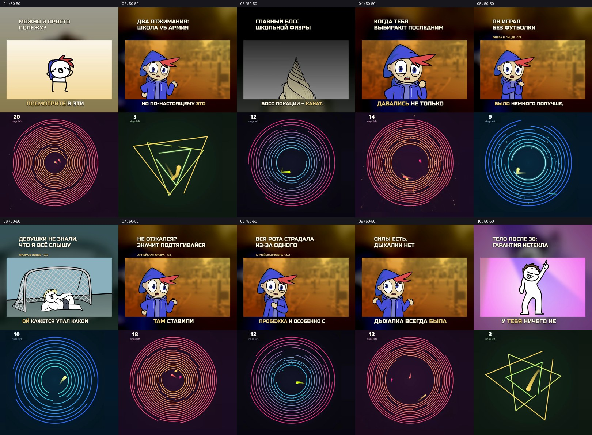

# Десять роликов: истории с физры + игра 50/50

Основной ролик, заголовок и прежние субтитры сверху; разные игровые отрезки снизу. Обе половины ровно 1080×960, весь кадр 1080×1920, 60 fps. Игры без звука, голос, музыка и эффекты основных роликов сохранены. Без баннеров.

## Скачать архивами

- [Архив 1: 89.1 МБ](https://raw.githubusercontent.com/kekkill/Videos/main/exports/phys-ed-gameplay-20261018/videos-pack-1.zip) — ролики 3, 4, 5, 6, 10.
- [Архив 2: 83.7 МБ](https://raw.githubusercontent.com/kekkill/Videos/main/exports/phys-ed-gameplay-20261018/videos-pack-2.zip) — ролики 1, 2, 7, 8, 9.

Архивы независимые: распакуйте оба, чтобы получить все десять MP4.

## Отдельные MP4

| № | Ролик | Часть | Длина | Скачать |
|---|---|---|---|---|
| 01 | Можно я просто ПОЛЕЖУ? | Отдельный момент | 29.17 с | [MP4 · 19.9 МБ](https://raw.githubusercontent.com/kekkill/Videos/main/exports/phys-ed-gameplay-20261018/phys-ed-gameplay-01-rest.mp4) |
| 02 | Два отжимания: ШКОЛА vs АРМИЯ | Отдельный момент | 10.25 с | [MP4 · 5.5 МБ](https://raw.githubusercontent.com/kekkill/Videos/main/exports/phys-ed-gameplay-20261018/phys-ed-gameplay-02-pushups.mp4) |
| 03 | Главный босс ШКОЛЬНОЙ ФИЗРЫ | Отдельный момент | 35.58 с | [MP4 · 14.8 МБ](https://raw.githubusercontent.com/kekkill/Videos/main/exports/phys-ed-gameplay-20261018/phys-ed-gameplay-03-rope.mp4) |
| 04 | Когда тебя ВЫБИРАЮТ ПОСЛЕДНИМ | Отдельный момент | 34.33 с | [MP4 · 20.1 МБ](https://raw.githubusercontent.com/kekkill/Videos/main/exports/phys-ed-gameplay-20261018/phys-ed-gameplay-04-volleyball.mp4) |
| 05 | Он играл БЕЗ ФУТБОЛКИ | Физра в лицее • 1/2 | 28.00 с | [MP4 · 13.8 МБ](https://raw.githubusercontent.com/kekkill/Videos/main/exports/phys-ed-gameplay-20261018/phys-ed-gameplay-05-classmate-1.mp4) |
| 06 | Девушки не знали, ЧТО Я ВСЁ СЛЫШУ | Физра в лицее • 2/2 | 49.75 с | [MP4 · 28.4 МБ](https://raw.githubusercontent.com/kekkill/Videos/main/exports/phys-ed-gameplay-20261018/phys-ed-gameplay-06-classmate-2.mp4) |
| 07 | Не отжался? ЗНАЧИТ ПОДТЯГИВАЙСЯ | Армейская физра • 1/2 | 21.33 с | [MP4 · 13.2 МБ](https://raw.githubusercontent.com/kekkill/Videos/main/exports/phys-ed-gameplay-20261018/phys-ed-gameplay-07-army-1.mp4) |
| 08 | Вся рота страдала ИЗ-ЗА ОДНОГО | Армейская физра • 2/2 | 48.42 с | [MP4 · 24.7 МБ](https://raw.githubusercontent.com/kekkill/Videos/main/exports/phys-ed-gameplay-20261018/phys-ed-gameplay-08-army-2.mp4) |
| 09 | Силы есть. ДЫХАЛКИ НЕТ | Отдельный момент | 38.83 с | [MP4 · 20.5 МБ](https://raw.githubusercontent.com/kekkill/Videos/main/exports/phys-ed-gameplay-20261018/phys-ed-gameplay-09-breath.mp4) |
| 10 | Тело после 30: ГАРАНТИЯ ИСТЕКЛА | Отдельный момент | 23.04 с | [MP4 · 12.0 МБ](https://raw.githubusercontent.com/kekkill/Videos/main/exports/phys-ed-gameplay-20261018/phys-ed-gameplay-10-after-thirty.mp4) |

Названия и порядок историй сохранены. В длинных роликах игры сменяются; пустые хвосты записей не используются. Кольца вписаны с одинаковым масштабом по горизонтали и вертикали. Счётчик перемещён в верхний левый угол нижней половины.

Изображение повторно кодировано H.264 CRF18. Исходная анимация 24 fps повторяет кадры до 60 fps, игра сохраняет 60 fps. Скорость действий и звука прежняя. У десятого ролика окончание видеодорожки округлено на 8,33 мс для сетки 60 fps.

Проверены все кадры субтитров, звуковые пакеты, декодирование, размеры и воспроизведение начала/конца всех MP4 в Chromium. [Отчёт](validation.json). [Проект](../../story-studio/batches/phys-ed-gameplay-20261018/README.md).
