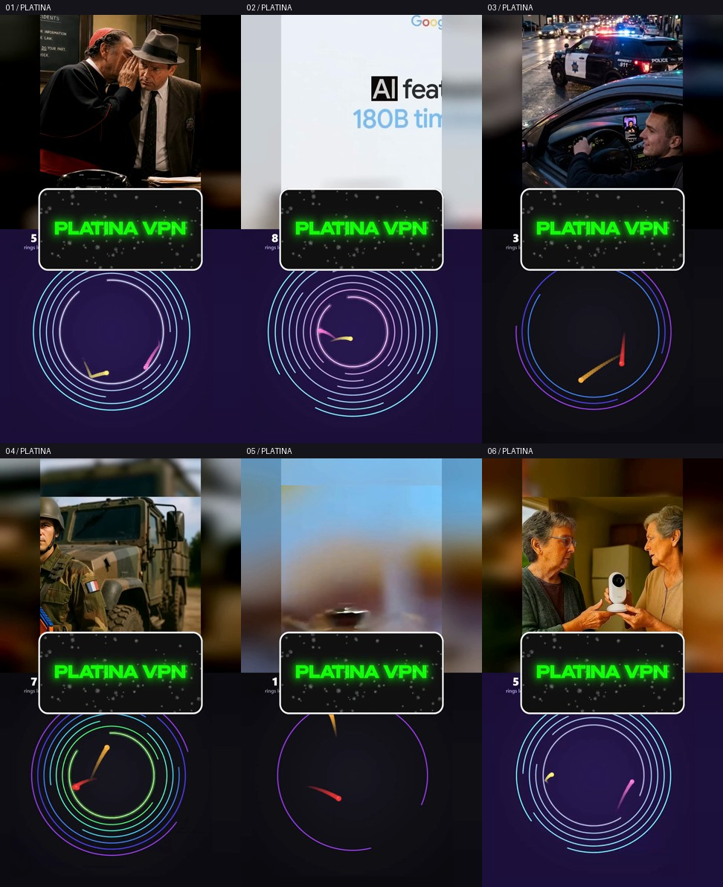

# Шесть роликов: шары + Platina VPN

Основной ролик с исходными субтитрами сверху, активные фрагменты игр снизу, ровно 50/50. Игры без звука. Сочетания и старты разные; пустые окончания игр исключены. Два из трёх игровых файлов содержат одинаковый видеопоток.

Исходный баннер Platina VPN ускорен до 1,3× с сохранением высоты голоса. Синий хромакей удалён, зелёные надписи сохранены. Баннер точно по центру, без дополнительных плашек.

На время рекламной речи всё изображение замирает на 3,75 с, основной звук отключён. Затем ролик продолжается с того же кадра с тихим звуком −18 dB до конца анимации (ещё 0,417 с). После исчезновения рекламы обычная громкость возвращается за 120 мс.

[Короткий пример вставки — 6,2 секунды](https://raw.githubusercontent.com/kekkill/Videos/main/exports/platina-gameplay-20261022/preview-insertion-6s.mp4). Полные ролики ниже.

## Скачать подборку

- [Архив 1 — 66.5 МБ](https://raw.githubusercontent.com/kekkill/Videos/main/exports/platina-gameplay-20261022/videos-pack-1.zip) — ролики 6.
- [Архив 2 — 62.7 МБ](https://raw.githubusercontent.com/kekkill/Videos/main/exports/platina-gameplay-20261022/videos-pack-2.zip) — ролики 4, 5.
- [Архив 3 — 76.9 МБ](https://raw.githubusercontent.com/kekkill/Videos/main/exports/platina-gameplay-20261022/videos-pack-3.zip) — ролики 1, 2, 3.

Это независимые ZIP: для всей подборки скачайте и распакуйте все архивы.

## Отдельные MP4

| № | Ролик | Длина | Вставка | Скачать |
|---|---|---|---|---|
| 01 | Бог наблюдает за этим всем  | 44.73 с | 21.33 с | [MP4 · 27.7 МБ](https://raw.githubusercontent.com/kekkill/Videos/main/exports/platina-gameplay-20261022/01-god-watches-platina.mp4) |
| 02 | Деньги достались правильным людям | 48.59 с | 23.95 с | [MP4 · 26.9 МБ](https://raw.githubusercontent.com/kekkill/Videos/main/exports/platina-gameplay-20261022/02-right-people-platina.mp4) |
| 03 | Подписчик завёз контента | 39.39 с | 17.05 с | [MP4 · 22.3 МБ](https://raw.githubusercontent.com/kekkill/Videos/main/exports/platina-gameplay-20261022/03-subscriber-content-platina.mp4) |
| 04 | Почему бы и нет | 78.54 с | 37.95 с | [MP4 · 39.9 МБ](https://raw.githubusercontent.com/kekkill/Videos/main/exports/platina-gameplay-20261022/04-why-not-platina.mp4) |
| 05 | Флеш в мире жуков | 28.80 с | 16.18 с | [MP4 · 22.8 МБ](https://raw.githubusercontent.com/kekkill/Videos/main/exports/platina-gameplay-20261022/05-fast-beetle-platina.mp4) |
| 06 | Шантажист | 96.75 с | 48.10 с | [MP4 · 66.5 МБ](https://raw.githubusercontent.com/kekkill/Videos/main/exports/platina-gameplay-20261022/06-blackmailer-platina.mp4) |

1080×1920, 60 fps, H.264 CRF18, AAC 320 кбит/с 48 кГц. Исходные голос, музыка и субтитры сохранены; скорость и ориентация основного ролика не меняются. Все исходные кадры и слова оставлены. Длина каждого ролика увеличена на 3,75 с. При необходимости ограничены только пики звука выше 0 dBFS, с компенсацией задержки; такие случаи записаны в audio.json проекта.

Проверены все кадры основного окна и субтитров, временные метки, точные звуковые пакеты первой стадии, игровые фрагменты, все 250 кадров рекламы в каждом ролике, края и уровни звука. Все MP4 декодируются и воспроизводятся с перемоткой в Chromium. [Основная компоновка](base-validation.json) · [Финальные проверки](validation.json) · [Воспроизведение](playback-check.json) · [Проект](../../split-screen-studio/batches/platina-gameplay-20261022/README.md).
