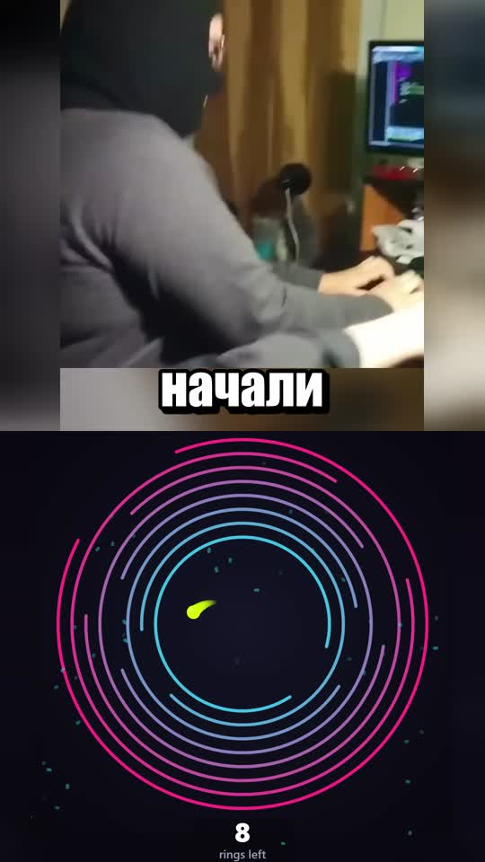

# Видео + игра: 50/50

[Скачать полный MP4 — 64,8 с, 47 МБ](https://github.com/kekkill/Videos/raw/refs/heads/main/exports/split-screen-20261017/video-game-split-50-50.mp4)

[Скачать короткий образец — первые 8 с, 5,4 МБ](https://github.com/kekkill/Videos/raw/refs/heads/main/exports/split-screen-20261017/preview-8s.mp4)

1080×1920, 60 fps. Верхние 50% занимает исходный ролик с сохранёнными
лицами и субтитрами, края заполнены размытием. Нижние 50% — обе предоставленные
игры подряд: первая 20 секунд, вторая 40 секунд. Оставшиеся 4,75 секунды
изображения заполнены началом второй игры. Кольца сохраняют круглую форму
и помещаются целиком, счётчик сохранён под ними.

Звук игр отключён. Все 2791 звуковой пакет основного ролика и их временные
метки сохранены без изменений. Все 3885 видеокадров декодируются без ошибок.
Воспроизведение, начало, переход игр, повтор и конец проверены в Chromium.
Видеоряд перекодирован в H.264 CRF 18; исходники не изменены.

[Проверки](validation.json) · [Параметры сборки](composition-manifest.json) ·
[Обзор кадров](final-contact.jpg) · [Воспроизводимый проект](../../split-screen-studio/README.md)
